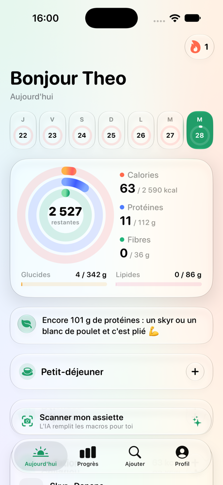
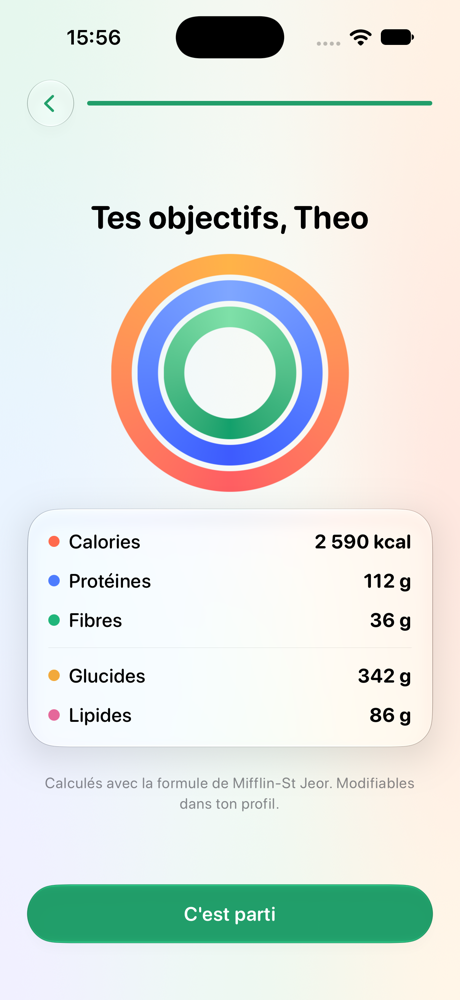
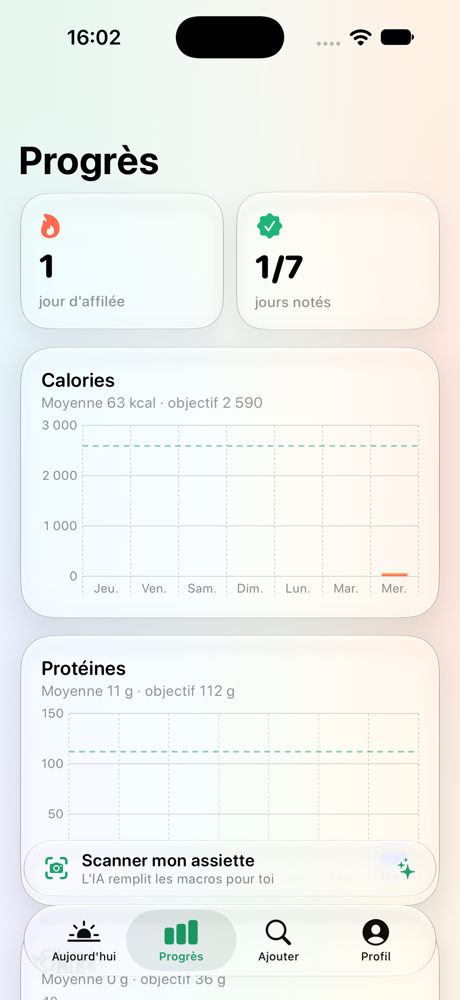

# Assiette 🥗

Compte tes calories avec un scan IA de tes plats. Design épuré façon **Liquid Glass**.

## 📲 Installer sur ton téléphone (gratuit, sans rien télécharger)

### 👉 **[sucrayyyy.github.io/assiette](https://sucrayyyy.github.io/assiette/)**

- **iPhone** : ouvre le lien dans **Safari**, touche **Partager** (le carré avec la flèche) puis **« Sur l'écran d'accueil »**. L'icône Assiette apparaît avec tes apps et s'ouvre en plein écran.
- **Android** : ouvre le lien dans **Chrome**, touche **« Installer l'application »** (ou menu ⋮ › Installer).

Tes données restent sur ton téléphone. Pour le scan IA, colle ta clé API Anthropic dans **Profil › Scan IA** (à créer sur [console.anthropic.com](https://console.anthropic.com)).

## Version iPhone native (Xcode / AltStore)

Le dossier `Assiette/` contient aussi une app iPhone native en SwiftUI.
Page AltStore : [sucrayyyy.github.io/assiette/altstore.html](https://sucrayyyy.github.io/assiette/altstore.html). Ou dans AltStore › Sources › **+**, colle cette adresse :

```
https://raw.githubusercontent.com/Sucrayyyy/assiette/main/docs/altstore.json
```

Fichier direct : [Assiette.ipa](https://github.com/Sucrayyyy/assiette/releases/download/v1.0/Assiette.ipa)

<p>
  
  
  
</p>

- **Accueil** : « Bonjour Théo », anneaux calories / protéines / fibres, glucides et lipides, semaine en un coup d'œil, série de jours 🔥 et petit message de coaching.
- **Besoins sur mesure** : formule de Mifflin-St Jeor (sexe, âge, taille, poids, activité, objectif), objectifs modifiables à la main.
- **Aliments** : aliments de base intégrés + **Open Food Facts** (toutes les marques vendues en France) + **scan de code-barres**.
- **Scan IA 📸** : tu prends ton plat en photo, Claude (IA d'Anthropic) détecte chaque ingrédient, estime les grammes et les macros. Ensuite tu ajustes :
  - les quantités avec − / + ;
  - « C'est autre chose » pour remplacer un ingrédient par un aliment de la base ;
  - « Corriger avec l'IA » : « le blanc c'est du riz complet, la sauce c'est de la crème », et elle réajuste tout le plat.
- **Progrès** : graphiques de la semaine (calories, protéines, fibres) et courbe de poids.

Aucune dépendance externe : pas de CocoaPods, pas de Swift Package. Juste Xcode.

## Installer le fichier .ipa (sans Xcode)

Le fichier `Assiette.ipa` est dans les [Releases](../../releases). Il n'est pas signé : iOS n'installe que des apps signées, donc un outil le signe avec ton identifiant Apple au moment de l'installer.

**Avec Sideloadly** (Mac ou PC, le plus simple) :
1. Installe [Sideloadly](https://sideloadly.io) et branche ton iPhone avec un câble.
2. Glisse `Assiette.ipa` dans Sideloadly, entre ton identifiant Apple, clique sur **Start**.
3. Sur l'iPhone : active le **Mode développeur** (Réglages › Confidentialité et sécurité), puis Réglages › Général › VPN et gestion de l'appareil › fais confiance à ton identifiant.

**Avec AltStore** : installe [AltStore](https://altstore.io) sur ton iPhone, télécharge `Assiette.ipa` depuis la Release sur ton iPhone, puis ouvre-le avec AltStore.

Avec un identifiant Apple gratuit, l'app doit être resignée tous les 7 jours (AltStore peut le faire automatiquement).

## Installer depuis Xcode

1. Clone le projet et ouvre `Assiette.xcodeproj` dans Xcode.
2. **Xcode › Réglages › Comptes** : ajoute ton identifiant Apple (gratuit).
3. Clique sur le projet **Assiette** › cible **Assiette** › **Signing & Capabilities** › choisis ton **Team**.
   Si Xcode refuse l'identifiant `fr.assiette.app`, remplace-le par un identifiant à toi (ex. `fr.tonprenom.assiette`).
4. Branche ton iPhone, active le **Mode développeur** (Réglages › Confidentialité et sécurité), choisis-le en haut d'Xcode et appuie sur ▶︎.
5. Sur l'iPhone, la première fois : Réglages › Général › VPN et gestion de l'appareil › fais confiance à ton compte développeur.

Avec un compte Apple gratuit, l'app doit être réinstallée depuis Xcode tous les 7 jours (limite d'Apple). Avec un compte développeur payant, elle reste installée un an et peut passer par TestFlight.

## Activer le scan IA

Crée une clé API sur [console.anthropic.com](https://console.anthropic.com), puis colle-la dans l'app : **Profil › Scan IA**.
Elle est stockée chiffrée dans le trousseau de l'iPhone et n'est jamais dans le code.

Modèle utilisé : `claude-opus-5-5`, avec repli automatique côté serveur (`fallbacks: "default"`) si une requête est refusée.

## Structure

```
Assiette/
├── App/            Point d'entrée, onglets
├── Model/          Données, calcul des besoins, stockage, trousseau
├── Services/       Base d'aliments, Open Food Facts, scan IA
├── Design/         Couleurs, fond, cartes Liquid Glass, anneaux
└── Views/          Accueil, Recherche, Scan, Progrès, Profil, Onboarding
```

Données nutritionnelles : [Open Food Facts](https://world.openfoodfacts.org) (licence ODbL) et valeurs moyennes de type CIQUAL (ANSES).
