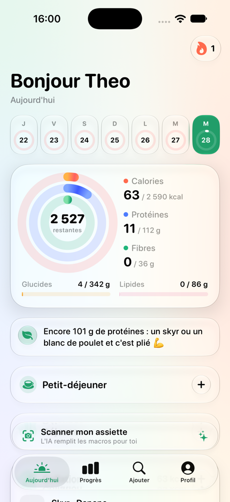
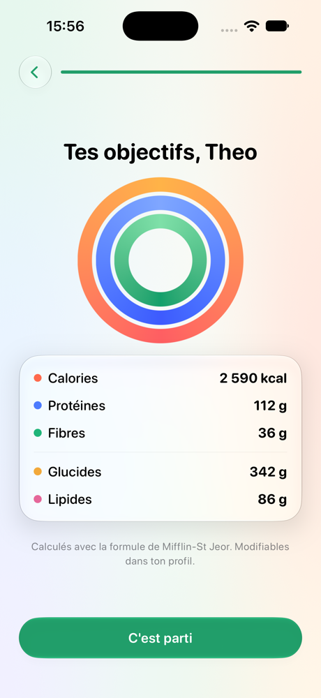
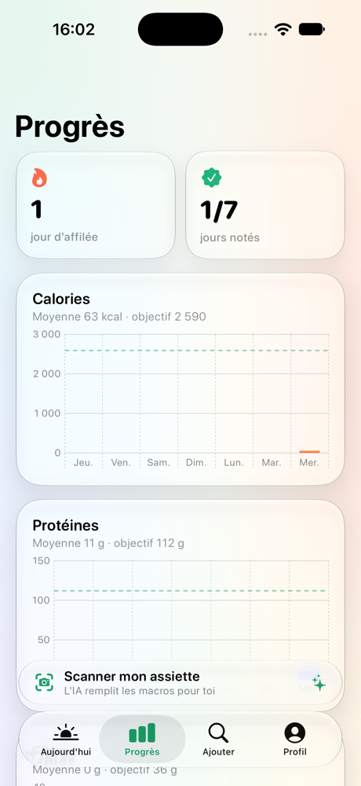

# Assiette 🥗

Calories, muscu, pas, eau et compléments : ta journée au même endroit. Design épuré façon **Liquid Glass**, à ta couleur.

## 📲 Installer sur ton téléphone (gratuit, sans rien télécharger)

### 👉 **[sucrayyyy.github.io/assiette](https://sucrayyyy.github.io/assiette/)**

- **iPhone** : ouvre le lien dans **Safari**, touche **Partager** (le carré avec la flèche) puis **« Sur l'écran d'accueil »**. L'icône Assiette apparaît avec tes apps et s'ouvre en plein écran.
- **Android** : ouvre le lien dans **Chrome**, touche **« Installer l'application »** (ou menu ⋮ › Installer).

Tes données restent sur ton téléphone.

### 🍽️ Nutrition

- **Plus de 68 000 produits d'Europe** intégrés (France, Belgique, Suisse, Allemagne, Espagne, Italie, Royaume-Uni…), recherche instantanée même hors ligne, plus la base mondiale Open Food Facts en ligne.
- **Scan de code-barres** rapide (caméra HD, mise au point continue, clé de contrôle, bip). Produit inconnu ? Tu le crées depuis l'étiquette et il est reconnu au prochain scan.
- **Rythme de perte ou de prise de poids** au choix (−0,25 à −1 kg par semaine, +0,25 ou +0,5 kg), avec les calories par jour affichées.
- **Pas** : reliés à l'app Santé de l'iPhone avec un raccourci Apple (instructions dans l'app), ou notés à la main. Les calories brûlées s'ajoutent à ta journée.
- **Citation du jour** animée à chaque ouverture.
- **Nutri-Score, niveau de transformation et additifs** sur la fiche des produits.
- **Comme hier** : un repas repris en un geste. **Ajout rapide** : juste les calories, pour le restaurant.
- **Recettes** : ton plat maison calculé à la part.
- **Mon corps** : photos avant/après avec curseur de comparaison et mensurations, gardées sur le téléphone.
- **Hydratation** : un verre en un geste, le niveau monte à l'écran.

### 💊 Compléments

- Créatine, whey, vitamines… avec dose, jours de prise et stock restant. La whey compte dans le journal.
- **Rappels à 16 h, 18 h et 20 h**, seulement si tout n'est pas pris, de plus en plus pressants : sur la carte du jour et en notification, même app fermée.
- Série de jours et régularité sur 30 jours.

### ✨ Le reste

- **Niveaux et XP** : chaque bonne habitude rapporte de l'XP (aliments notés, protéines, eau, pas, compléments, séances, journée parfaite), avec des passages de niveau célébrés.
- **Défis du jour** : trois défis chaque matin, et un **coffre** à ouvrir quand ils sont tous faits (bonus d'XP ou gel de série qui protège ta série).

- **Couleur d'accentuation au choix** (15 teintes ou sur mesure), thème clair, sombre ou auto.
- **Écran d'accueil à la carte** et **score du jour** : tous tes objectifs cochés, c'est une journée parfaite.
- **Ma semaine** : récap animé façon story, avec une note sur 100 et une image à partager.
- **32 trophées** à débloquer, avec une vraie célébration.
- **Ton vrai métabolisme**, mesuré sur ta courbe de poids et ce que tu manges, et **date estimée** pour ton poids visé.
- **Calendrier du mois**, gestes natifs (tirer une feuille pour la fermer, glisser pour changer de jour), retour haptique, sauvegarde de tes données.
- Le scan IA des assiettes est mis en pause pour le moment.

### 🏋️ Muscu

- **Coach** : une conversation de 7 questions (objectif, niveau, jours, durée, matériel, priorités, douleurs). Il analyse tes séances actuelles, garde ce qui marche, corrige le reste et construit un programme d'hypertrophie sur mesure (fréquence 2 fois par semaine, 10 à 20 séries par muscle, double progression, décharge toutes les 6 semaines). La séance du jour suit ton programme, et le coach fait un bilan chaque semaine.

- **Séances** : libre, perso (tu crées les tiennes) ou programmes prêts (Full body, Push/Pull/Legs, Haut/Bas, Force 5×5, Abdos, Sans matériel).
- **1 758 exercices**, chacun avec un personnage animé vu de face (ou de dos) et les muscles travaillés en couleur, filtrables par muscle et par matériel.
- **Séance du jour** : le programme dont les muscles sont les plus reposés.
- **Record détecté en direct** dès que la série est validée, **écran toujours allumé** pendant la séance.
- **Charger la barre** : les disques dessinés pour chaque poids et l'échauffement calculé.
- **Surcharge progressive** : à chaque série, tes anciens scores, les poids pré-remplis et la prochaine marche à viser. Records 🏆 détectés automatiquement.
- **Fiche exercice** : un personnage 3D musclé fait le mouvement en continu (on le fait tourner au doigt), muscles travaillés en rouge, la vraie photo du mouvement en médaillon, les étapes et le schéma détaillé des muscles.
- **Séries par muscle** sur la semaine, avec la zone 10 à 20 qui fait progresser. **Chrono** Tabata, HIIT, EMOM ou sur mesure.
- **Récupération** : schéma du corps coloré selon la fatigue de chaque muscle.
- **Rangs** (Fer → Légende), niveaux de force et **classement entre amis** par lien de partage.

Exercices : [wger](https://wger.de) (CC-BY-SA 4.0) et [free-exercise-db](https://github.com/yuhonas/free-exercise-db) (domaine public).
Photos des mouvements : free-exercise-db (domaine public). Moteur 3D : [three.js](https://threejs.org) (MIT) ; le personnage et ses mouvements sont faits pour Assiette. Schéma du corps : [react-native-body-highlighter](https://github.com/HichamELBSI/react-native-body-highlighter) (MIT, © 2022 ELABBASSI Hicham).

## Version iPhone native (Xcode / AltStore)

Le dossier `Assiette/` contient aussi une app iPhone native en SwiftUI.
Page AltStore : [sucrayyyy.github.io/assiette/altstore.html](https://sucrayyyy.github.io/assiette/altstore.html). Ou dans AltStore › Sources › **+**, colle cette adresse :

```
https://raw.githubusercontent.com/Sucrayyyy/assiette/main/docs/altstore.json
```

Fichier direct : [Assiette.ipa](https://github.com/Sucrayyyy/assiette/releases/download/v1.0/Assiette.ipa)

<p>
  
  
  
</p>

- **Accueil** : « Bonjour Théo », anneaux calories / protéines / fibres, glucides et lipides, semaine en un coup d'œil, série de jours 🔥 et petit message de coaching.
- **Besoins sur mesure** : formule de Mifflin-St Jeor (sexe, âge, taille, poids, activité, objectif), objectifs modifiables à la main.
- **Aliments** : aliments de base intégrés + **Open Food Facts** (toutes les marques vendues en France) + **scan de code-barres**.
- **Scan IA 📸** : tu prends ton plat en photo, Claude (IA d'Anthropic) détecte chaque ingrédient, estime les grammes et les macros. Ensuite tu ajustes :
  - les quantités avec − / + ;
  - « C'est autre chose » pour remplacer un ingrédient par un aliment de la base ;
  - « Corriger avec l'IA » : « le blanc c'est du riz complet, la sauce c'est de la crème », et elle réajuste tout le plat.
- **Progrès** : graphiques de la semaine (calories, protéines, fibres) et courbe de poids.

Aucune dépendance externe : pas de CocoaPods, pas de Swift Package. Juste Xcode.

## Installer le fichier .ipa (sans Xcode)

Le fichier `Assiette.ipa` est dans les [Releases](../../releases). Il n'est pas signé : iOS n'installe que des apps signées, donc un outil le signe avec ton identifiant Apple au moment de l'installer.

**Avec Sideloadly** (Mac ou PC, le plus simple) :
1. Installe [Sideloadly](https://sideloadly.io) et branche ton iPhone avec un câble.
2. Glisse `Assiette.ipa` dans Sideloadly, entre ton identifiant Apple, clique sur **Start**.
3. Sur l'iPhone : active le **Mode développeur** (Réglages › Confidentialité et sécurité), puis Réglages › Général › VPN et gestion de l'appareil › fais confiance à ton identifiant.

**Avec AltStore** : installe [AltStore](https://altstore.io) sur ton iPhone, télécharge `Assiette.ipa` depuis la Release sur ton iPhone, puis ouvre-le avec AltStore.

Avec un identifiant Apple gratuit, l'app doit être resignée tous les 7 jours (AltStore peut le faire automatiquement).

## Installer depuis Xcode

1. Clone le projet et ouvre `Assiette.xcodeproj` dans Xcode.
2. **Xcode › Réglages › Comptes** : ajoute ton identifiant Apple (gratuit).
3. Clique sur le projet **Assiette** › cible **Assiette** › **Signing & Capabilities** › choisis ton **Team**.
   Si Xcode refuse l'identifiant `fr.assiette.app`, remplace-le par un identifiant à toi (ex. `fr.tonprenom.assiette`).
4. Branche ton iPhone, active le **Mode développeur** (Réglages › Confidentialité et sécurité), choisis-le en haut d'Xcode et appuie sur ▶︎.
5. Sur l'iPhone, la première fois : Réglages › Général › VPN et gestion de l'appareil › fais confiance à ton compte développeur.

Avec un compte Apple gratuit, l'app doit être réinstallée depuis Xcode tous les 7 jours (limite d'Apple). Avec un compte développeur payant, elle reste installée un an et peut passer par TestFlight.

## Activer les notifications de compléments

Sur iPhone, une notification app fermée doit venir d'un serveur. Le dossier `push/` en contient un tout petit, gratuit sur Cloudflare, qui ne connaît ni tes compléments ni tes données : il réveille le téléphone, qui écrit lui-même le message.

```bash
cd push && npm install && npm run setup
```

La commande demande de se connecter à Cloudflare (compte gratuit), met le serveur en ligne et branche l'app dessus. Sur iPhone, les notifications ne marchent que depuis l'icône ajoutée à l'écran d'accueil (iOS 16.4 ou plus).

## Activer le scan IA

Crée une clé API sur [console.anthropic.com](https://console.anthropic.com), puis colle-la dans l'app : **Profil › Scan IA**.
Elle est stockée chiffrée dans le trousseau de l'iPhone et n'est jamais dans le code.

Modèle utilisé : `claude-opus-5-5`, avec repli automatique côté serveur (`fallbacks: "default"`) si une requête est refusée.

## Structure

```
Assiette/
├── App/            Point d'entrée, onglets
├── Model/          Données, calcul des besoins, stockage, trousseau
├── Services/       Base d'aliments, Open Food Facts, scan IA
├── Design/         Couleurs, fond, cartes Liquid Glass, anneaux
└── Views/          Accueil, Recherche, Scan, Progrès, Profil, Onboarding
```

Données nutritionnelles : [Open Food Facts](https://world.openfoodfacts.org) (licence ODbL) et valeurs moyennes de type CIQUAL (ANSES).
